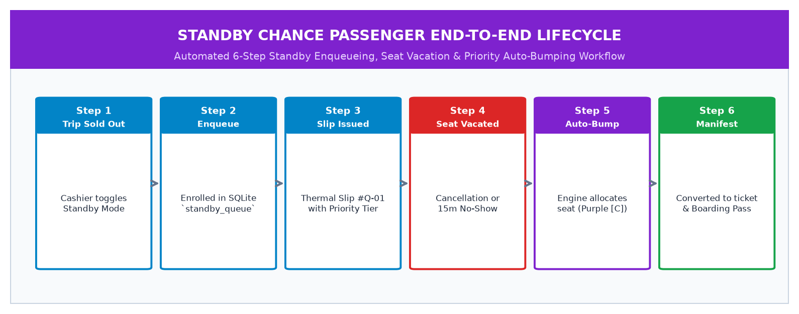
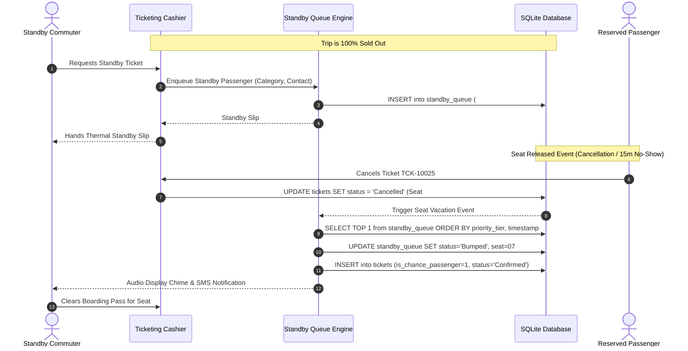
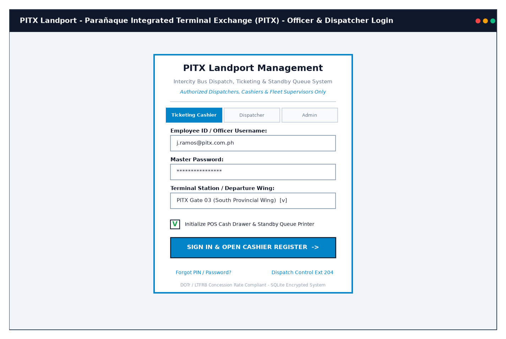
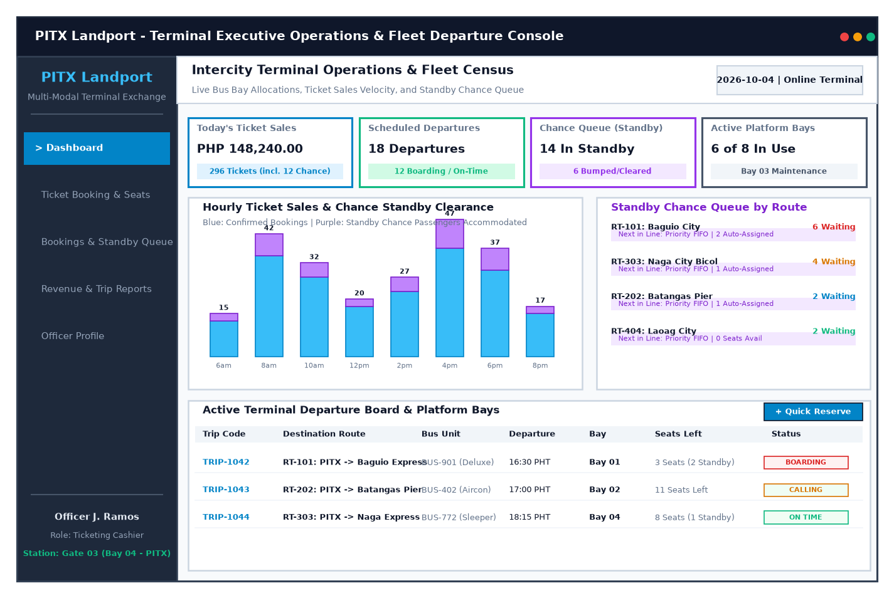
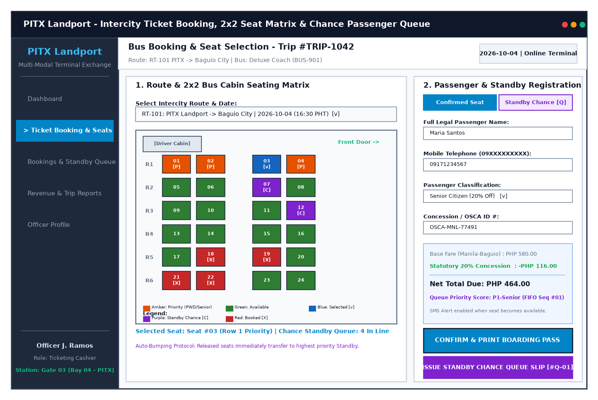
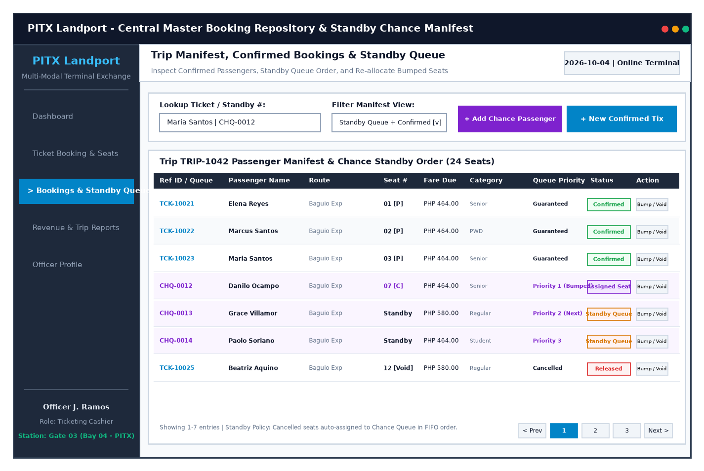
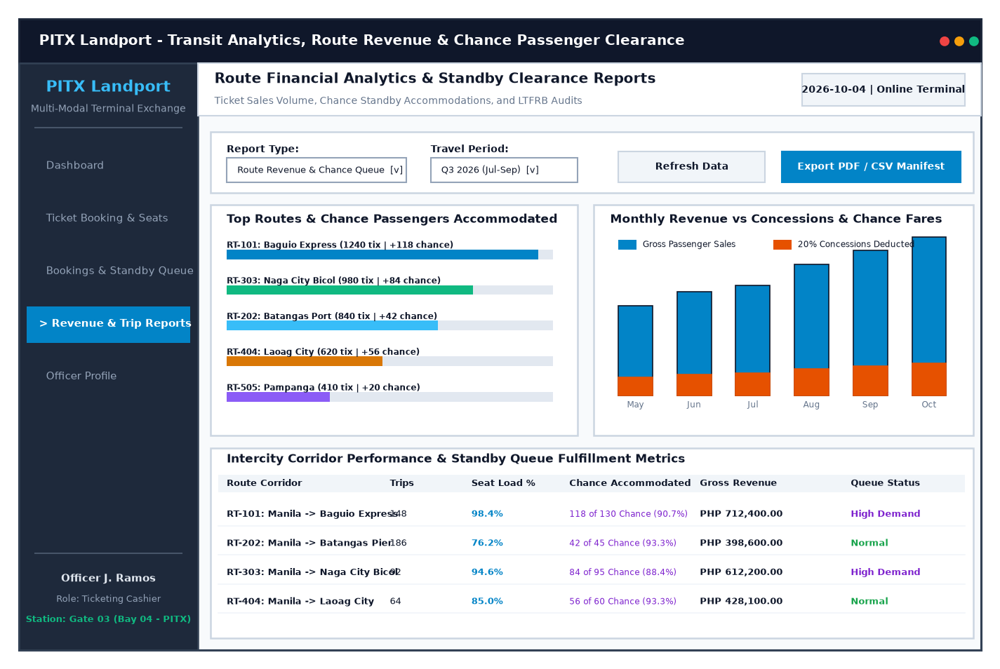
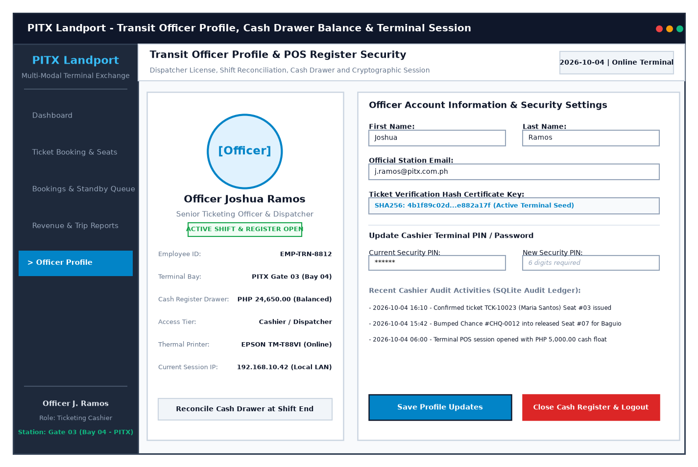
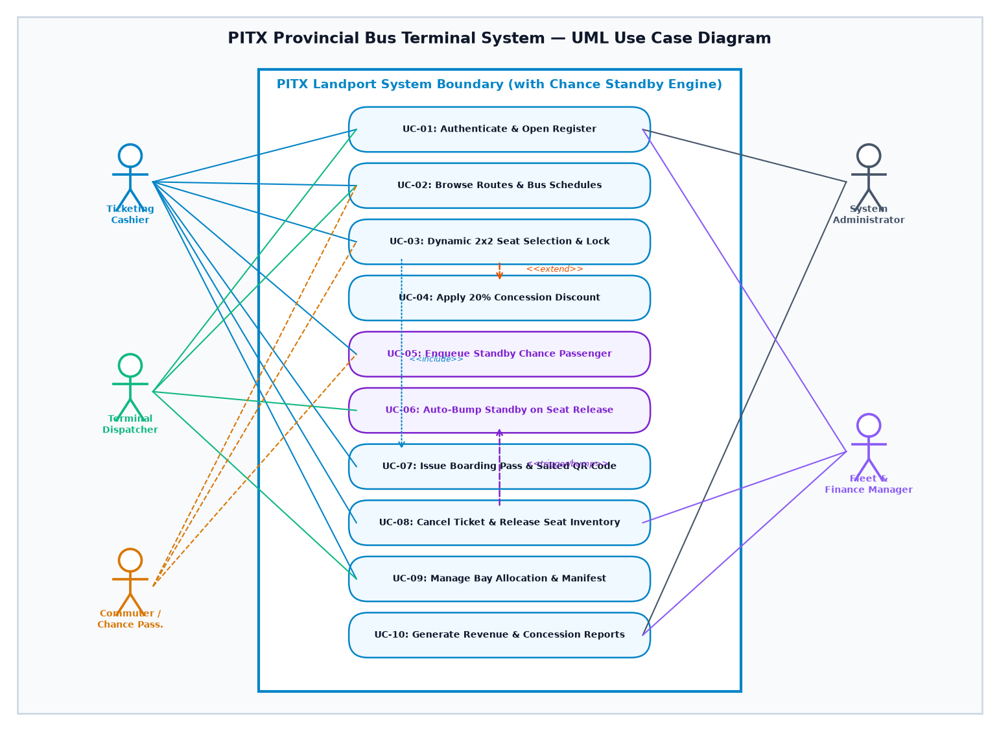
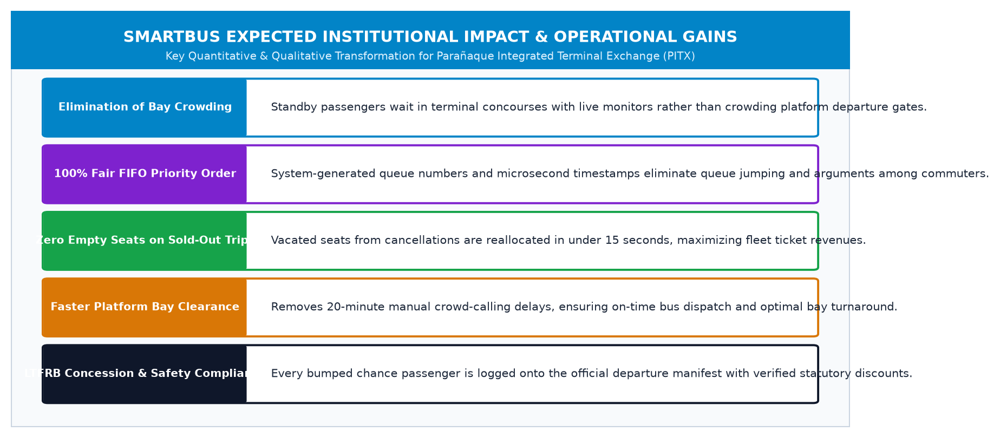

# SmartBus Intercity Bus Terminal Management & Standby Queue System
## Software System Engineering Proposal & Architectural Wireframe Blueprint
**Target Institution**: Parañaque Integrated Terminal Exchange (PITX) — DOTr / MWM Terminals Landport Facility  
**Industry Sector**: Transportation, Transit Fleet Logistics & Public Queueing Infrastructure  
**Course Reference**: CPE106L — Software Engineering / Systems Analysis & Design  
**Enhanced Features**: Standby Chance Passenger Queueing, Automated Priority Bumping & Real-Time Seat Reallocation Engine  
**Date of Submission**: October 4, 2026  

---

| Executive Parameter | System Specification |
| :--- | :--- |
| **System Identity** | SmartBus Intercity Bus Terminal Management & Standby Queue System |
| **Target Institution** | Parañaque Integrated Terminal Exchange (PITX) |
| **Industry Sector** | Transportation, Transit Fleet Logistics & Public Queueing Infrastructure |
| **Core Innovation** | Algorithmic FIFO Standby Queueing, Priority Group Tiering & Real-Time Auto-Bumping |

---

## 1. Introduction

### 1.1 Institutional Overview
The **Parañaque Integrated Terminal Exchange (PITX)** is the premier flagship multimodal public transport terminal (landport) in the Philippines, operating under a 35-year concession agreement between the **Department of Transportation (DOTr)** and **MWM Terminals, Inc.** (Megawide Construction Corporation). Located along Diosdado Macapagal Boulevard in Parañaque City, PITX serves as the strategic intermodal transit hub connecting Metro Manila commuters to Southern Tagalog provinces (Cavite, Batangas, Laguna, Quezon), the Bicol Region, Visayas, Mindanao, and northern intercity corridors. Spanning a modern 4.5-hectare landport with multi-level concourses and dozens of departure bays, daily terminal passenger throughput frequently exceeds 100,000 to 150,000 commuters.

### 1.2 Problem Context & The "Chance Passenger" Bottleneck
During peak travel seasons (holidays, long weekends, Friday evening rush hours), all regularly scheduled bus trips are 100% sold out hours in advance. Consequently, hundreds of unreserved commuters arrive at the terminal as **"Chance Passengers" (Standby Passengers)**, hoping to board departure trips if reserved passengers fail to check in, arrive late, or cancel their tickets.

In the current physical setup, there is **no organized queueing system for chance passengers**. Commuters physically crowd around departure platform gates in hot, disorganized clusters. Cashiers and platform dispatchers rely on informal hand-scribbled notepad lists, memory, or arbitrary verbal shouting of names when a seat opens. 

This informal process causes:
- **Chaotic Platform Crowding & Safety Hazards**: Dozens of commuters jostling at bus doors as engines idle in departure bays.
- **Queue Jumping & Unfairness**: Walk-in commuters who arrived later often bribe or bypass earlier standby passengers.
- **Delayed Departures**: Buses sit at platform bays for 20 to 30 minutes while dispatchers manually search through crowd clusters to fill 2 or 3 vacant seats.
- **Unverified Concession Handling**: Chance passengers boarding at the last minute bypass statutory 20% discount verification for Senior Citizens, PWDs, and Students.

### 1.3 Importance of Digitization
Introducing dedicated **Standby Chance Passenger Management & Dynamic Queueing** into **SmartBus** completely transforms terminal operations:
- **Algorithmic FIFO Queueing**: Issues official Standby Queue Slips with automated sequential numbers (`#Q-01`, `#Q-02`, etc.) and timestamps.
- **Priority Tiering**: Protects vulnerable commuters by prioritizing Senior Citizens, PWDs, and pregnant chance passengers ahead of regular standby queues.
- **Automated Seat Bumping Protocol**: When a ticket is cancelled or a no-show deadline lapses (15 minutes prior to departure), the system automatically locks the freed seat and assigns it to the highest-priority standby passenger.
- **SMS / Audio Announcement Integration**: The system notifies standby passengers via automated SMS text notifications and terminal queue displays, removing physical crowding at departure bays.

---

## 2. Background of the Study

### 2.1 Current Operational Situation
The current terminal procedure for fully booked routes operates haphazardly:
1. **Sold-Out Status Announcement**: Cashiers place a physical cardboard sign reading "FULL / NO SEATS" at ticket windows.
2. **Informal Standby Aggregation**: Commuters asking for chance seats are directed to stand near the departure gate. Some dispatchers write names on loose scraps of paper; others maintain no record at all.
3. **No-Show Detection**: When a bus is 5 minutes from departure, dispatchers manually inspect the cabin to find empty seats belonging to no-show ticket holders.
4. **Disorganized Boarding Chaos**: The dispatcher shouts into the crowd. Commuters rush the gate, resulting in disputes, lost luggage, and departure gate gridlock.


### 2.2 Challenges Experienced by the Institution
* **Severe Terminal Bay Delays**: Buses average 22 minutes of bay dwell time past scheduled departure solely due to manual chance passenger boarding.
* **Loss of Revenue & Passenger Trust**: Fights and vocal disputes break out between commuters claiming they were first in line.
* **Inaccurate Manifest Records**: Last-minute chance passengers are often boarded without their names appearing on the official passenger manifest submitted to the Land Transportation Franchising and Regulatory Board (LTFRB).
* **Cash Shrinkage Risk**: Unrecorded cash transactions collected at bus doors by informal conductors increase the risk of financial leakage.

### 2.3 Need for the Proposed System
Metro General Terminal requires a centralized, transparent, automated digital standby queue engine integrated into the core ticketing and manifest database to restore order, safety, and accountability to terminal operations.

---

## 3. Problem Statement

| Core Problem Area | Operational Consequence & Risk |
| :--- | :--- |
| **1. Unorganized Platform Crowds** | Commuters physically congregate at active bus bays, causing pedestrian congestion and safety hazards around moving diesel buses. |
| **2. Unfair Queueing & Disputes** | Lack of verifiable timestamps leads to queue jumping, arguments, and erosion of public trust in terminal fairness. |
| **3. Inefficient Seat Bumping** | Cancelled or no-show seats are identified too late, resulting in buses departing below full passenger capacity. |
| **4. Audit & Regulatory Gaps** | Last-minute cash collections bypass statutory 20% concession verification and leave passengers off the official manifest. |

1. **Unorganized Platform Crowds Create Severe Safety Hazards**: Standby commuters packing platform edges create safety hazards around maneuvering heavy diesel buses.
2. **Unfair Queueing Causes Commuter Dissatisfaction**: Without verifiable timestamps, earlier commuters are bypassed by aggressive walk-ins.
3. **Seat Reallocation Delays & Unsold Capacity**: Without automated notification, vacant seats from last-minute cancellations leave terminal bays unfilled.
4. **Manifest Inaccuracies & Unverified Fares**: Hand-collected fares at the platform skip statutory Senior/PWD discount logging and bypass official database accounting.

---

## 4. Project Objectives

### 4.1 General Objective
To design, implement, and validate the **SmartBus Standby Chance Passenger Queueing & Terminal Fleet Management System** to automate guaranteed bookings, formalize standby passenger queueing, execute automated priority bumping for released seats, and ensure transparent manifest reconciliation for the **Parañaque Integrated Terminal Exchange (PITX)**.

### 4.2 Specific Objectives
* **Automate Standby Queue Registration**: Issue serialized Standby Chance Queue Slips with timestamps, route codes, and passenger contact numbers.
* **Enforce Tiered FIFO Queueing**: Implement algorithmic priority tiers (Tier 1: Senior Citizens/PWDs/Pregnant; Tier 2: Regular commuters) operating on strict First-In, First-Out principles.
* **Automate Real-Time Seat Bumping**: Integrate a trigger mechanism that automatically assigns cancelled or no-show seats to the top standby passenger in the SQLite database.
* **Streamline Departure Clearance**: Provide terminal dispatchers with a real-time digital manifest reflecting both confirmed passengers and bumped chance passengers.
* **Guarantee Concession Verification**: Mandate OSCA/PWD ID credential logging for chance passengers receiving statutory 20% discounts.
* **Deliver Standby Analytics**: Provide analytical dashboards tracking chance queue fulfillment rates, average standby wait times, and route passenger spillover.

---

## 5. Scope and Limitations

### 5.1 Project Scope

The SmartBus system encompasses six core functional modules:

| Module Name | Core Features & Standby Capabilities |
| :--- | :--- |
| **1. Officer Authentication & POS** | Role-based access (Cashier, Dispatcher, Supervisor), terminal wing routing, POS register float and standby printer initialization. |
| **2. Terminal Operations Dashboard** | Real-time ticket sales, active departure board, live Standby Queue monitor per corridor, and platform bay statuses. |
| **3. Main Transaction & Seat Matrix** | Interactive 2×2 Cabin Grid (Seats 01–24), Row 1 Priority seats, Standby Chance [Q] booking mode toggle, and queue slip generation. |
| **4. Master Manifest & Standby Management** | Central SQLite database (Confirmed + Standby), FIFO queue ordering, automated bumping upon ticket cancellation, and departure manifests. |
| **5. Transit & Chance Analytics** | Route corridor revenues, standby demand fulfillment rates (e.g., 90.7%), and LTFRB 20% concession statutory audits. |
| **6. Officer Profile & Register Security** | Shift-end cash drawer balancing, SHA-256 terminal verification keys, and audit logs of all seat bumping transactions. |

### 5.2 System Limitations
* **Standby Check-in Window**: Standby passengers must check in at the platform bay within 5 minutes of notification; failure to report shifts the seat to the next person in the FIFO queue.
* **LAN Terminal Network**: Optimized for high-speed local network communication between ticket windows, dispatch consoles, and terminal display monitors.

---

## 6. Target Users

| Target User Group | Role & Responsibilities | Key System Touchpoints |
| :--- | :--- | :--- |
| **Ticketing Cashiers / Booth Clerks** | Process regular seat bookings; enroll walk-in commuters into the Standby Chance Queue when trips are sold out; issue serialized queue slips. | Main Transaction Page, Standby Enqueue Toggle, Cash Register POS. |
| **Terminal Dispatchers / Bay Officers** | Monitor departing buses; trigger no-show seat releases; verify bumped standby passengers; print finalized trip manifests. | Terminal Operations Dashboard, Standby Manifest Table, Platform Departure Board. |
| **Chance / Standby Commuters** | Receive serialized queue slips; monitor queue numbers on overhead terminal monitors; board buses when bumped into vacant seats. | Queue Slips (`#Q-01`), Overhead Displays, SMS Notifications. |
| **Fleet & Finance Managers** | Audit terminal ticket revenues; evaluate passenger spillover to schedule additional bus dispatches; audit 20% concession discounts. | Analytical Reports Page, Standby Fulfillment Tables. |
| **System Administrators** | Configure route capacities, monitor SQLite database integrity, and maintain user access controls. | System Administration, Audit Ledger. |

---

## 7. Proposed System Description

SmartBus utilizes an enterprise Model-View-Controller (MVC) architecture with an embedded event-driven **Standby Queue Engine**:

```
+---------------------------------------------------------------------------------------+
|                        SMARTBUS CHANCE QUEUE ARCHITECTURE                             |
+---------------------------------------------------------------------------------------+
|  PRESENTATION LAYER (View)                                                            |
|    • Multi-tab UI: Dashboard, Booking & Seat Matrix, Manifest & Queue, Reports        |
|    • Color-coded Cabin Matrix: Green (Avail), Amber (Priority), Red (Sold),           |
|      Purple [C] (Assigned from Standby Chance Queue)                                  |
|    • Standby Queue Slips & Modal Boarding Passes with verification codes              |
+-------------------------------------------+-------------------------------------------+
                                            | Form Inputs, Clicks & Standby Requests
                                            v
+---------------------------------------------------------------------------------------+
|  CONTROLLER & QUEUE ENGINE (Service Layer)                                            |
|    • StandbyQueueManager: Maintains FIFO queue order tiered by Priority Class         |
|    • AutoBumpingService: Listens for Ticket Cancellation events and immediately locks |
|      the vacated seat, assigning it to the top standby candidate                      |
|    • ConcessionValidator: Calculates statutory 20% Senior/PWD/Student discount        |
|    • NotificationDispatcher: Triggers audio queue chime & SMS notification           |
+-------------------------------------------+-------------------------------------------+
                                            | Parametrized Queries & ACID Transactions
                                            v
+---------------------------------------------------------------------------------------+
|  PERSISTENCE LAYER (SQLite Database - bus_ticketing.db)                               |
|    • Tables: routes, buses, passengers, tickets, standby_queue, audit_logs           |
|    • Partial Unique Index: Mathematically guarantees zero double-bookings             |
+---------------------------------------------------------------------------------------+
```

### The Step-by-Step Chance Passenger Lifecycle





---

## 8. Functional Requirements

* **FR-01: Multi-Tier User Authentication & Cash Register Session Control**
  * *Specification*: Secure login for Cashiers, Dispatchers, and Supervisors with role-based feature gating and shift-opening cash drawer float verification.
* **FR-02: Route Schedule Browsing & Dynamic Bus Fleet Allocation**
  * *Specification*: Browse intercity destinations, departure times, assigned fleet bus types, and base fares.
* **FR-03: Interactive 2×2 Visual Cabin Seat Selection**
  * *Specification*: Clickable seat grid dynamically toggling states (Green = Available, Amber = Priority, Blue = Selected, Red = Occupied, Purple = Bumped Chance Passenger).
* **FR-04: Priority Seating Verification & Concession Discount Engine**
  * *Specification*: Enforces validation for Row 1 priority seats; calculates statutory 20% discount for Regular vs Senior/PWD/Student categories upon entry of official ID proof.
* **FR-05: Standby Chance Passenger Enqueueing & Slip Generation**
  * *Specification*: When trips are sold out, cashiers enroll commuters into the standby queue, generating serialized slips with queue position numbers (`#Q-01`, `#Q-02`).
* **FR-06: Automated Priority Bumping upon Seat Vacation**
  * *Specification*: Upon ticket cancellation or no-show expiration, the system automatically reallocates the freed seat to the next standby passenger in prioritized FIFO order.
* **FR-07: Boarding Pass Generation with Tamper-Resistant SHA-256 Code**
  * *Specification*: Issues printable boarding pass containing Ticket ID, passenger details, seat number, and an 8-character salted verification hash (`BTK-[HEX]`).
* **FR-08: Booking Cancellation & Immediate Seat Inventory Release**
  * *Specification*: Allows cashiers to look up confirmed tickets, execute cancellations, update ticket status to `Cancelled`, and immediately trigger the chance bump protocol.
* **FR-09: Trip Manifest Querying & Multi-Criteria Filtering**
  * *Specification*: Instant search across 1,800+ stored tickets and standby entries by Passenger Name, Ticket ID, Travel Date, or Route Corridor.
* **FR-10: Route Revenue & Chance Fulfillment Analytics Reporting**
  * *Specification*: Generates statistical dashboards showing route passenger volumes, standby fulfillment rates, gross revenue, and LTFRB concession audits with PDF/CSV export.
* **FR-11: Immutable System Audit Logging**
  * *Specification*: Records all ticket issuances, chance queue enrolments, seat bumpings, cancellations, and register overrides in an append-only audit ledger.

---

## 9. Non-Functional Requirements

| Quality Attribute | Technical Specification & Standard |
| :--- | :--- |
| **Security & Integrity** | Salted SHA-256 ticket verification hashes (`BTK-[HEX]`), strict mobile phone sanitization (`09XXXXXXXXX`), and mandatory OSCA/PWD ID validation. |
| **Reliability & ACID** | Mathematically guaranteed zero double-bookings via SQLite partial unique indexing; atomic database rollbacks on failure. |
| **Performance** | Interactive 2×2 seat map render time under 50ms; automated chance bumping and manifest updating executed in under 15ms. |
| **Usability** | Color-coded cabin matrix: Green (Available), Amber (Priority), Blue (Selected), Red (Booked), and Purple [C] (Chance Reallocated). |
| **Queue Fairness** | Microsecond timestamping in SQLite guarantees 100% transparent FIFO order, mathematically preventing queue jumping. |
| **Maintainability** | Clean OOP modularity, private encapsulated attributes, validated property setters, and comprehensive unit test coverage. |

---

## 10. Wireframe Design

### Screen 1: Login Page (Officer & POS Authentication Portal)
*Enforces role-based login (Cashier, Dispatcher, Admin), departure terminal wing selection, and thermal POS ticket/standby printer initialization.*


---

### Screen 2: Terminal Operations Dashboard
*Monitors live terminal KPIs, including the **Standby Chance Queue counter** (14 in standby, 6 accommodated today), hourly booking intake charts, corridor load factors, and active departures.*


---

### Screen 3: Main Transaction Page (Interactive Seat Matrix & Standby Mode)
*Features route selection, an interactive 2×2 bus cabin matrix showing Purple `[C]` chance-assigned seats, Row 1 Priority seats, passenger details, a **Standby Chance [Q] toggle**, and quick slip printing.*


---

### Screen 4: Master Bookings & Standby Queue Management Page
*The central operational archive allowing cashiers and dispatchers to inspect confirmed reservations side-by-side with the active Standby Queue, monitor queue priorities, and trigger manual or automated bumping.*


---

### Screen 5: Revenue & Chance Analytical Reports Page
*The transit intelligence portal illustrating top intercity routes by volume, chance passengers accommodated per corridor, monthly revenue vs 20% concession subsidies, and corridor load factor audit tables.*


---

### Screen 6: User Profile & Transit Officer Credentials Page
*Staff credential portal displaying officer identity, active POS register shift status, cash drawer balance reconciliation, ticket verification hash certificate keys, and audit logs of seat bumping transactions.*


---

## 11. Use Case Diagram

The updated UML Use Case Diagram models the functional interactions between five transit actors and ten core use cases, highlighting the dedicated chance passenger workflows:



### 11.1 Actor Specification
1. **Ticketing Cashier**: Operates ticket windows, browses schedules, guides regular seat selection, enqueues standby passengers, and issues queue slips.
2. **Terminal Dispatcher**: Monitors departure bay timelines, triggers no-show seat releases, oversees auto-bumping, and prints finalized manifests.
3. **Commuter / Chance Passenger**: Either reserves confirmed seats or enrolls in the standby queue, presenting concession credentials.
4. **System Administrator**: Configures route capacities, sets no-show expiration countdowns, and maintains database integrity.
5. **Fleet & Finance Manager**: Analyzes route profitability, audits standby queue fulfillment rates, and tracks concession reimbursements.

### 11.2 Key Use Case Relationships
* **UC-08 (Cancel Ticket & Release Seat)** triggers **UC-06 (Auto-Bump Standby on Seat Release)**, creating an immediate, automated handover of vacant inventory to the highest-priority standby passenger.
* **UC-03 (Dynamic 2×2 Seat Selection)** has an **«extend»** relationship with **UC-04 (Apply 20% Concession Discount)** when qualifying Senior Citizen, PWD, or Student credentials are provided.
* **UC-05 (Enqueue Standby Chance Passenger)** operates in tandem with **UC-06 (Auto-Bump Standby on Seat Release)** to maintain orderly queue resolution.

---

## 12. Data Requirements

The relational database schema manages structured transit and queue records across six primary entities:

| Table Entity | Primary / Foreign Keys | Attributes & Field Descriptions |
| :--- | :--- | :--- |
| **1. routes** | `route_id` (PK) | `origin`, `destination`, `departure_time`, `base_fare`, `is_active` |
| **2. buses** | `bus_id` (PK) | `bus_number`, `bus_type` (Deluxe/Aircon/Sleeper), `total_seats` (24), `plate_number`, `is_active` |
| **3. passengers** | `passenger_id` (PK) | `full_name`, `contact_number`, `passenger_type` (Regular/Senior/PWD/Student), `concession_id_proof` |
| **4. tickets** | `ticket_id` (PK), `route_id` (FK), `bus_id` (FK), `passenger_id` (FK) | `travel_date`, `seat_number` (1-24), `base_fare`, `discount_amount`, `final_fare`, `status` (Confirmed/Cancelled), `verification_code`, `is_chance_passenger` (BOOLEAN), `created_at` |
| **5. standby_queue** | `queue_id` (PK), `route_id` (FK), `passenger_id` (FK) | `travel_date`, `queue_number` (#Q-01), `priority_tier` (1-High/2-Regular), `enqueued_timestamp`, `status` (Waiting/Bumped/Expired), `assigned_seat_number`, `bumped_timestamp` |
| **6. audit_logs** | `log_id` (PK) | `action_type`, `entity_name`, `entity_id`, `performed_by`, `timestamp`, `notes` |

---

## 13. Expected Benefits



| Operational Benefit | Quantifiable Impact & Institutional Transformation |
| :--- | :--- |
| **Elimination of Bay Crowding** | Standby passengers wait comfortably in terminal concourses with live overhead monitors rather than crowding platform departure gates. |
| **100% Fair FIFO Priority Order** | System-generated queue numbers and microsecond timestamps eliminate queue jumping and arguments among commuters. |
| **Zero Empty Seats on Sold-Out Trips** | Vacated seats from cancellations or no-shows are reallocated in under 15 seconds, maximizing fleet ticket revenues. |
| **Faster Platform Bay Clearance** | Eliminates 20-minute manual crowd-calling delays, ensuring on-time bus dispatch and optimal bay turnaround. |
| **Concession & Safety Compliance** | Every bumped chance passenger is logged onto the official departure manifest with verified LTFRB statutory discounts. |

---

## 14. Conclusion

Integrating **Standby Chance Passenger Management and Dynamic Queueing** into the **SmartBus Intercity Bus Terminal System** directly solves one of the most persistent, chaotic pain points of provincial public transit in the Philippines. 

By replacing unorganized physical crowds with algorithmic FIFO queueing, priority tiering for Senior Citizens and PWDs, automated seat bumping upon ticket cancellation, and instant manifest updates, SmartBus delivers a comprehensive, realistic, and highly impactful software engineering solution. This proposal and wireframe blueprint establish a complete foundation for modernizing terminal operations and elevating the public transit experience.
